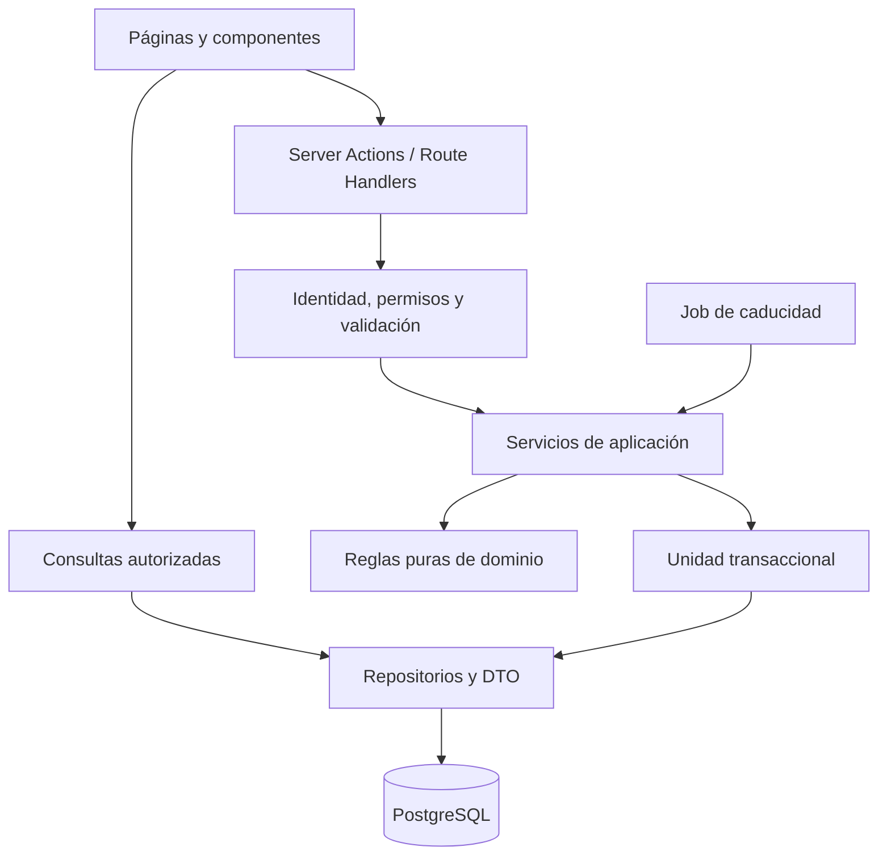
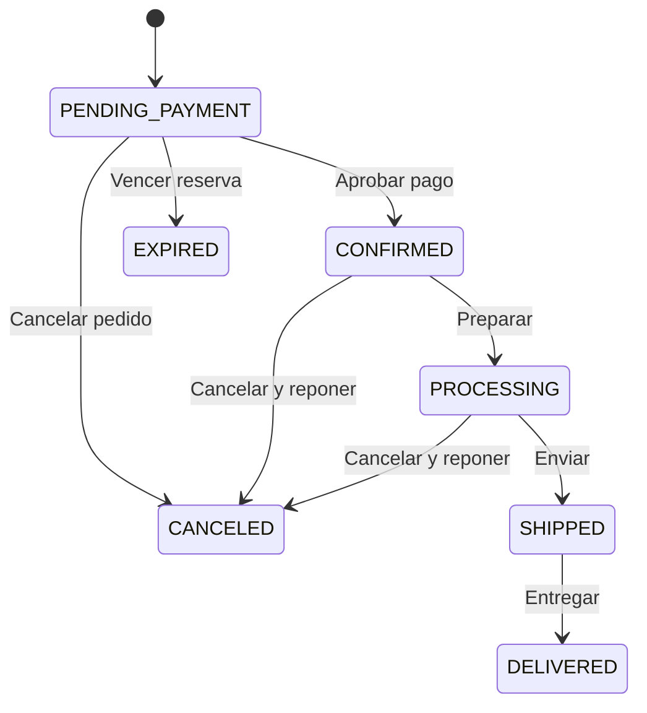

# NOVA STORE · Arquitectura y reglas de negocio

Versión 1.0 · 27 de octubre de 2026 · Especificación; sin implementación ni pruebas ejecutadas.

## 1. Decisiones técnicas

**Monolito modular con Next.js App Router y runtime Node.js**, PostgreSQL como fuente de verdad y Prisma para persistencia/migraciones según la versión elegida. Una sola aplicación desplegable. SQL parametrizado se admite dentro de repositorios para bloqueos, restricciones o consultas que el ORM no exprese bien.

| Componente | Decisión y motivo |
|---|---|
| Next.js + TypeScript | Mantener. Server Components para lecturas; componentes cliente solo donde hay interacción; modo estricto |
| Tailwind CSS + shadcn/ui | Mantener. Tokens propios y componentes seleccionados; no instalar una biblioteca entera de patrones sin uso |
| PostgreSQL + Prisma | Mantener. Relaciones, restricciones, transacciones y migraciones reproducibles |
| Auth.js | Mantener como preferencia, sujeto a verificar versión soportada y compatible en E0; Credentials + sesiones JWT explícitas |
| Recharts | Mantener; carga en rutas administrativas, con tabla equivalente accesible |
| Vitest + Playwright | Mantener. Dominio y servicios con Vitest; navegador y Server Components asíncronos mediante Playwright |
| Zod | Añadir para contratos de entrada y entorno validados en servidor; evita esquemas improvisados |
| Argon2id | Añadir biblioteca mantenida compatible con Node para hashes de contraseña; nunca cifrado reversible |
| Testing Library + axe-core | Añadir como dependencias de desarrollo para comportamiento de componentes y controles de accesibilidad |
| Gestor de paquetes | pnpm con versión fijada y lockfile; conservar otro gestor si el repositorio ya lo utiliza coherentemente |

No fijar números de versión por memoria ni instalar `latest` sin verificar compatibilidad. En E0 producir una matriz con Node LTS, React, Next.js, Prisma/cliente/driver, Auth.js, Tailwind/shadcn y herramientas de prueba. Fijar versiones exactas y engines después del smoke test. La documentación consultada de Prisma ya describe una API transaccional distinta de ejemplos antiguos: no mezclar recetas de distintas versiones. Este documento usa contratos y pseudocódigo independientes de la API concreta.

Auth.js no sustituye el servicio de registro ni la autorización. La aplicación persiste User y su hash; el proveedor Credentials verifica esas credenciales. Para este alcance no se requiere adaptador Prisma de Auth.js ni tablas OAuth. Si la versión elegida exige otra combinación, resolver en E0 con prueba de integración y ADR antes de desarrollar funcionalidades dependientes.

## 2. Límites y flujo de dependencias



- Las páginas no ejecutan escrituras ni acceden directamente a tablas sensibles. Los servicios definen el caso de uso completo.
- `domain/` contiene dinero, transiciones y reglas puras, sin React ni Prisma. `server/` se marca `server-only`.
- Server Actions son adaptadores finos de formularios. Los Route Handlers se reservan para Auth.js, jobs y necesidades HTTP reales. No duplicar una API REST completa para la misma UI.
- Cada entrada autentica y cada servicio vuelve a exigir un actor verificado y sus permisos. Consultas devuelven DTO mínimos, no modelos completos.
- Lecturas de catálogo pueden tener caché breve e invalidación por producto/categoría. Carrito, sesión, pedidos, stock decisorio, cotización y administración no usan caché pública. Invalidar después del commit; un fallo de invalidación no debe deshacer o repetir una compra ya guardada.
- Los componentes cliente nunca importan el cliente de base de datos, hashes, secretos ni tipos que transporten estos valores.

## 3. Identidad, roles y aislamiento

JWT en cookie segura administrada por Auth.js. Incluir solo identificador, `sessionVersion` y tiempos necesarios. No guardar JWT en localStorage. El rol mostrado en cliente es informativo: para toda lectura privada o mutación se consulta User activo y su rol actual. Incrementar `sessionVersion` al revocar accesos, cambiar contraseña o desactivar cuenta; comparar con el token. Duración máxima de sesión propuesta: 8 horas, sin renovación más allá de ese límite absoluto sin reautenticación.

| Acción | Anónimo | CUSTOMER | ADMIN |
|---|---|---|---|
| Ver catálogo público | Sí | Sí | Sí |
| Carrito local | Sí | No es la autoridad | No es la autoridad |
| Carrito servidor / checkout | No | Propio | Propio |
| Leer/cancelar pedido de cliente | No | Solo propio y según estado | Cualquier pedido desde servicio administrativo |
| Simular pago | No | Solo propio | Solo propio; no aprobar pagos de terceros |
| Productos/cupones/configuración/ajustes | No | No | Sí, con auditoría |
| Avanzar preparación/envío/entrega | No | No | Sí |
| Gestionar roles / reset total de datos | No | No | No desde web; operación de mantenimiento fuera de la UI |
| Caducar reservas | No | No | El job usa identidad SYSTEM propia, no una sesión admin |

Control de propiedad en la consulta (`id` y `userId`), no únicamente después de obtener datos. Para identificadores ajenos responder 404 sin revelar existencia. Una ruta administrativa conocida puede devolver 403. El layout o proxy/middleware solo mejora navegación; no constituye la barrera de autorización. Para escrituras críticas, comprobar nuevamente rol/actividad en la transacción y serializar frente a revocaciones concurrentes.

## 4. Máquina de estados del pedido

| Código | Etiqueta | Significado |
|---|---|---|
| PENDING_PAYMENT | Pendiente de pago demo | Pedido creado, stock reservado, fecha límite establecida |
| CONFIRMED | Confirmado | Pago aprobado, stock consumido |
| PROCESSING | En preparación | Administración prepara el pedido ficticio |
| SHIPPED | Enviado (simulado) | Seguimiento ficticio; ya no admite cancelación |
| DELIVERED | Entregado (simulado) | Finalizado |
| CANCELED | Cancelado | Terminal; puede tener pago cancelado o reembolsado |
| EXPIRED | Reserva vencida | Terminal por falta de aprobación antes del límite |



| Desde → hacia | Actor / condición | Efectos indivisibles |
|---|---|---|
| Nuevo → PENDING_PAYMENT | Propietario autenticado; cotización vigente y aceptada; disponibilidad | Crear snapshots, Payment PENDING, reservas y retención de cupón; consumir carrito |
| PENDING_PAYMENT → CONFIRMED | Propietario; resultado APPROVED; `dbNow < expiresAt` | Aprobar pago; consumir reserva y stock; canjear cupón; generar número de recibo DEMO |
| PENDING_PAYMENT → CANCELED | Propietario o ADMIN | Liberar reservas y retención de cupón; cerrar Payment como CANCELED |
| PENDING_PAYMENT → EXPIRED | SYSTEM o comando que detecta caducidad; `dbNow >= expiresAt` | Liberar reservas/cupón; Payment EXPIRED |
| CONFIRMED → PROCESSING | ADMIN; versión esperada | Evento de preparación |
| PROCESSING → SHIPPED | ADMIN; seguimiento `DEMO-…` | Fecha de envío y evento |
| SHIPPED → DELIVERED | ADMIN | Fecha de entrega y evento |
| CONFIRMED → CANCELED | Propietario o ADMIN | Reembolso simulado completo y reposición única |
| PROCESSING → CANCELED | Solo ADMIN | Reembolso simulado completo y reposición única |

DELIVERED, CANCELED y EXPIRED son terminales. No hay retrocesos, reapertura ni saltos. Un rechazo de pago no cambia el estado del pedido. Para repetir una compra cancelada se crea otro pedido y se verifica nuevamente disponibilidad/precios. Las acciones administrativas exigen `expectedVersion` para detectar dos pestañas o dos operadores.

## 5. Máquina de estados del pago y sus intentos

Hay un Payment por pedido y muchos PaymentAttempt. El pago es una entidad agregada; los intentos son registros terminales e inmutables. El simulador no llama a ningún proveedor externo.

| Desde | Hacia permitido | Disparador |
|---|---|---|
| PENDING | APPROVED / DECLINED / CANCELED | Primer intento de simulación |
| DECLINED / CANCELED | PENDING | Nuevo intento, solo si el pedido sigue PENDING_PAYMENT y no venció |
| PENDING / DECLINED / CANCELED | EXPIRED | Caducidad del pedido |
| PENDING / DECLINED | CANCELED | Cancelación del pedido pendiente |
| CANCELED | CANCELED, sin nueva transición | Cancelación del pedido cuando el último intento ya estaba cancelado |
| APPROVED | REFUNDED | Cancelación válida de CONFIRMED/PROCESSING |
| REFUNDED / EXPIRED | Ninguno | Terminal |

`APPROVED` no admite nuevos intentos. `REFUNDED` significa devolución contable ficticia del total: no sale dinero. No hay reembolso parcial ni estado ambiguo «pagado y rechazado».

Cada llamada de simulación acepta únicamente `APPROVE`, `DECLINE` o `CANCEL`. Se traduce a un PaymentAttempt con `APPROVED`, `DECLINED` o `CANCELED`, importe copiado de Payment, ordinal, código descriptivo y correlationId. En reintentos, el paso agregado a PENDING y el resultado final se registran en eventos dentro de **la misma transacción**; no queda una tarea de pago asíncrona esperando en memoria. Una animación visual no controla el resultado.

**Cancelar un intento no cancela el pedido.** La UI debe ofrecer por separado «Cancelar intento» y «Cancelar pedido». Rechazo y cancelación del intento conservan la reserva hasta su vencimiento original. Los fallos técnicos revierten la transacción y se muestran como errores técnicos, nunca como rechazos bancarios ficticios. Máximo cinco intentos terminales por pedido; agotados, se permite cancelar o esperar caducidad. Un reenvío idempotente no cuenta como intento nuevo.

### Invariantes entre entidades

- PENDING_PAYMENT admite Payment PENDING, DECLINED o CANCELED y reservas ACTIVE hasta su expiración efectiva.
- CONFIRMED, PROCESSING, SHIPPED y DELIVERED requieren Payment APPROVED y reservas CONSUMED.
- EXPIRED requiere Payment EXPIRED y reservas RELEASED.
- CANCELED sin aprobación previa requiere Payment CANCELED y reservas RELEASED.
- CANCELED tras aprobación requiere Payment REFUNDED, un Refund por el total y reservas CONSUMED con movimientos de reposición. Una reserva consumida nunca vuelve a ACTIVE.
- La suma de intentos APPROVED por Payment es como máximo uno. El total del pago coincide con el total inmutable del pedido.

## 6. Dinero, descuentos e impuestos de demostración

Solo USD. Persistir importes en centavos enteros; porcentajes en puntos básicos: `1000 bps = 10%`. No usar float para cálculo monetario. Redondeo HALF_UP para importes no negativos: `roundBps(cents,bps) = floor((cents*bps + 5000)/10000)`, usando enteros seguros/BigInt en operaciones intermedias. Formatear al final mediante Intl para español de Ecuador, con USD explícito.

Orden obligatorio de cálculo:

1. `S = sum(unitPriceCents × quantity)`, usando precio actual del servidor al cotizar.
2. Validar cupón: activo, `startsAt <= dbNow < endsAt`, mínimo sobre S, alcance global, límite global y por usuario.
3. `D = min(S, descuento)`. Porcentaje: roundBps(S, bps), limitado por maxDiscount si existe. Fijo: amountCents. Un cupón; no se apilan promociones. `compareAtPrice` es información visual y no genera otro descuento.
4. `N = S - D`. Distribuir D proporcionalmente entre líneas con método del mayor resto: parte entera, luego centavos restantes por fracción descendente y SKU ascendente para desempatar.
5. Envío H: estándar 499 centavos, gratis si N >= 8000; exprés 999; retiro 0. No aplicar el cupón a envío. Son valores configurables versionados.
6. Base B = N + H solo si `taxShipping=true`; de lo contrario B=N. `T = roundBps(B,taxBps)` si habilitado, en caso contrario T=0.
7. `total = N + H + T`. Distribuir T por mayor resto entre líneas netas y, si corresponde, envío. Si B=0, todas las asignaciones de impuesto son cero.

Reglas adicionales: precio unitario 1–1.000.000 centavos; 1–10 unidades/SKU; máximo 30 SKU/carrito. Cada tarifa de envío se limita a 100.000 centavos; umbrales monetarios, descuentos fijos y topes de cupón a 300.000.000. El subtotal máximo es 300.000.000 y, con envío máximo y tasa del 100% también sobre envío, el total máximo es 600.200.000 centavos: cabe en integer de PostgreSQL. Los productos intermedios del redondeo se calculan con enteros seguros/BigInt. Si se amplían límites, revisar overflow antes de migrar. El total puede ser cero con un cupón del 100%, tasa cero y retiro: igualmente requiere una aprobación simulada explícita, sin atajos de estado.

Tasa inicial deshabilitada/0%; rango administrativo 0–10000 bps. Etiqueta invariable: **«Impuesto simulado, sin validez fiscal»**. No denominarlo IVA legal ni inferir tasas por país. El envío no tributa por defecto. Cada pedido congela tasa, base, distribución, regla de envío y descuento; cambios de configuración solo afectan nuevas cotizaciones.

Ejemplo de aceptación: 2 unidades de USD 29,90 + 1 de USD 49,90 = S 10970. Cupón 10%: D 1097, N 9873. Estándar gratis: H 0. Tasa de prueba 10%: T 987. Total 10860 = USD 108,60. Las líneas reciben descuento 598 y 499; impuestos 538 y 449. Este ejemplo es aritmético, no tributario.

### Cupones y concurrencia

CouponUsage puede estar RESERVED, REDEEMED o RELEASED. Al crear pedido, reservar una utilización. `RESERVED + REDEEMED` cuenta contra límites global y por usuario; al aprobar pasa a REDEEMED; al cancelar sin aprobación o caducar pasa a RELEASED. La cancelación posterior a aprobación **no devuelve** el cupo utilizado. Evita explotar cancelaciones para reutilizar una promoción. Un cupón que vence o se desactiva después de reservar sigue válido para ese pedido hasta su fecha límite. No reducir límites por debajo del consumo más reservas vigentes; futuras cotizaciones leen la nueva configuración.

## 7. Carrito y cotización

Invitado: localStorage contiene exclusivamente una versión de formato, identificadores y cantidades. No contiene datos de dirección, sesión ni precios confiables. Al identificarse, el servidor fusiona una única vez una clave `guestMergeId` con el carrito del cliente; suma por SKU, limita a 10 y a disponibilidad actual, descarta productos no vendibles y devuelve un resumen de cambios. Carrito no reserva unidades. Dos solicitudes concurrentes de fusión se deduplican con IdempotencyRecord y bloqueo del carrito.

Cliente: Cart/CartItem en PostgreSQL, con `version`. Cantidades deseadas pueden quedar por encima de disponibilidad tras compras ajenas; se señalan y bloquean checkout hasta corregir. Mutaciones usan versión y devuelven 409/`STALE_VERSION` cuando corresponde. La UI puede ser optimista para cantidades, pero revierte errores.

CheckoutQuote es una cotización persistida de 5 minutos: usuario, carrito/version, selección de envío, dirección ficticia, cupón, precios, versión comercial, desglose y hash canónico. No reserva stock ni cupón. Al confirmar, el servidor recarga todos los datos, valida disponibilidad y recalcula; cualquier diferencia comercial devuelve `QUOTE_CHANGED` con nueva cotización y exige confirmación. Agotamiento devuelve `OUT_OF_STOCK`. No aceptar totales enviados por navegador.

Una quote puede originar como máximo un Order, incluso si llegan claves idempotentes diferentes. La confirmación consume las líneas del carrito incluidas y aumenta su versión en la misma transacción; la comparación de versión impide borrar compras agregadas en otra pestaña. Cancelar no rellena el carrito automáticamente; «Volver a agregar» revalida con precios actuales.

## 8. Inventario, reservas y reposición

Por producto: `available = onHand - reserved`; `onHand >= 0`, `reserved >= 0`, `reserved <= onHand`. En esta demo onHand es stock contable no vendido: la venta lo reduce al aprobar, no al enviar. El envío no descuenta otra vez.

| Operación | Δ onHand | Δ reserved | Registro |
|---|---:|---:|---|
| Alta inicial / reposición administrativa | +q | 0 | OPENING / RESTOCK |
| Reservar | 0 | +q | RESERVE; reserva ACTIVE |
| Aprobar | −q | −q | SALE; reserva CONSUMED |
| Cancelar pendiente / caducar | 0 | −q | RELEASE; reserva RELEASED |
| Cancelar después de aprobar | +q | 0 | CANCEL_RESTOCK; reserva sigue CONSUMED |
| Ajuste por diferencia de conteo | ±q | 0 | ADJUSTMENT con motivo; resultado >= reserved |

La reserva vence 15 minutos después de crear pedido, con hora de base de datos. No se renueva por reintentos, recargas o cambios en configuración. Un job cada minuto busca candidatos vencidos y procesa cada pedido en una transacción idempotente. Dos workers pueden encontrar el mismo pedido: la comprobación bajo bloqueo impide liberar dos veces. No usar `setTimeout` como mecanismo durable.

Antes de pagar o cancelar, si el pedido pendiente ya venció, el servicio primero ejecuta la transición EXPIRED en la propia transacción y devuelve el estado guardado. No lanzar una excepción que haga rollback de esa expiración. Una consulta GET no muta datos: si detecta una reserva vencida aún no procesada, muestra «Reserva vencida, actualizando» y deshabilita pago. Hasta que el job libere el contador, el catálogo puede subestimar disponible, nunca sobreestimarlo para adjudicar ventas. Alerta si el retraso del job supera dos minutos.

Bloquear aprobación, cancelación y expiración sobre la misma fila Order. En el instante límite gana la regla temporal bajo bloqueo, no el reloj del navegador. Obtener `dbNow` efectivo después de adquirir bloqueos, para no decidir con una hora anterior a una espera prolongada.

Stock bajo = `available <= reorderPoint`, inclusive cero; agotado = available=0. Alertas son consultas derivadas, no registros que puedan quedar desincronizados. Archivar un producto bloquea nuevas compras, pero permite completar reservas existentes y conservar su historial.

## 9. Atomicidad, idempotencia y recuperación

Todos los comandos que coordinan pedido/pago/reserva/cupón usan una transacción PostgreSQL **SERIALIZABLE**, con bloqueos de filas y actualizaciones condicionadas. Los servicios internos reciben el mismo contexto `tx`; no abren transacciones independientes ni usan el cliente global dentro de la unidad.

Orden común de bloqueos cuando las filas existan: clave idempotente → usuarios ordenados → carrito → pedido → configuración/cupón → productos e inventario ordenados por ID → reservas/usos dependientes. Todos los servicios, incluidos ajustes administrativos, respetan el orden relativo. Nunca bloquear inventario y luego intentar bloquear un pedido. Documentar excepciones y probar interbloqueos.

Ejemplo conceptual de reserva (SQL parametrizado, no código listo para ejecutar):

```sql
UPDATE inventory
SET reserved = reserved + :quantity, version = version + 1
WHERE product_id = :productId
  AND on_hand - reserved >= :quantity;
-- Exigir exactamente una fila modificada por cada SKU.
-- Si alguna falla: revertir pedido, cupón, movimientos y todas las reservas.
```

El esquema aporta CHECK/FK/UNIQUE; la transacción aporta invariantes entre tablas. Una lectura previa de stock seguida de escritura sin condición no es suficiente. Reintentar serialización/deadlock como máximo tres veces con espera breve aleatoria; reconstruir decisiones a partir de nuevas lecturas. Agotados los reintentos devolver conflicto recuperable, conservando la misma clave. No reintentar errores de validación. No realizar redes, render de recibos, demoras simuladas ni tareas costosas dentro de la transacción.

### Contrato idempotente

Cada comando crítico incluye UUID aleatorio `idempotencyKey`: crear pedido, simular pago, cancelar, avanzar estado, ajustar inventario, fusionar carrito. El servidor define actor y scope; nunca confía en un actor recibido. IdempotencyRecord tiene UNIQUE(actorKey, scope, key), hash SHA-256 del payload normalizado y referencia/respuesta mínima del resultado.

- Misma clave + mismo hash + mismo actor: devolver el resultado original, sin repetir efectos. Revalidar sesión y permiso antes de devolverlo.
- Resolver ese replay después de autenticar/validar el formato y antes de rechazar una versión antigua, quote vencida o estado terminal; esos valores pueden haber cambiado precisamente por el primer éxito. Si la misma quote ya produjo un pedido con otra clave, devolver referencia autorizada al pedido existente o un conflicto explícito, nunca crear otro.
- Misma clave + distinto hash: 409 `IDEMPOTENCY_CONFLICT`.
- Dos llamadas simultáneas: la unicidad/bloqueo serializa; la segunda espera brevemente o recibe «operación en curso» y reintenta con la misma clave.
- Registrar resultado y efectos en la misma transacción; no guardar un éxito antes del commit. Un rollback no deja un registro de éxito.
- Un error de red después del commit se recupera reenviando la misma clave. Un rechazo de pago es resultado de negocio exitosamente registrado; se reproduce como tal.
- Mantener registros al menos siete días. Aun después de purgarlos, UNIQUE(quoteId), un solo pago aprobado, un Refund y movimientos únicos por causa previenen duplicados de negocio. Comandos terminales devuelven estado actual sin repetir efectos.
- Persistir la clave de una operación en curso en sessionStorage hasta conocer su resultado. No reutilizarla para un intento de pago realmente nuevo.

### Unidades transaccionales mínimas

| Comando | Debe confirmarse o revertirse junto |
|---|---|
| createOrder | Autorización, quote vigente, precios, Order/Items, Payment, reservas, movimientos, cupón reservado, consumo de carrito, evento e idempotencia |
| simulatePayment(APPROVE) | Intento, Payment, Order, consumos, cupón canjeado, identificador de recibo, eventos e idempotencia |
| simulatePayment(DECLINE/CANCEL) | Intento, Payment y eventos; conserva reservas; idempotencia |
| cancelOrder sin pago / expireOrder | Estado de Order/Payment, liberación de reservas/cupón, movimientos y eventos |
| cancelOrder pagado | Order CANCELED, Payment REFUNDED, Refund, reposición, movimientos, auditoría si ADMIN e idempotencia |
| adjustInventory / admin transition | Autorización actual, versión esperada, cambio, movimiento/evento, auditoría e idempotencia |

Si falla guardar un evento/auditoría obligatoria, se revierte la operación. El recibo se renderiza después desde snapshots; un fallo de impresión permite reabrirlo sin volver a aprobar el pago. No se necesita patrón outbox mientras no existan efectos externos. Si se agregan notificaciones o proveedores, será una nueva decisión arquitectónica.

## 10. Contratos de servicio y errores

Servicios propuestos: `searchCatalog`, `getProduct`, `setCartItem`, `mergeGuestCart`, `createQuote`, `createOrder`, `simulatePayment`, `cancelOrder`, `advanceOrder`, `expireOrder`, `adjustInventory`, `saveProduct`, `saveCoupon`, `publishSettings`, `getDashboard`.

Entrada crítica de pago: `{orderId, scenario, expectedVersion, idempotencyKey}`. Entrada de pedido: `{quoteId, cartVersion, idempotencyKey}`. Ajuste: `{productId, delta, reason, expectedVersion, idempotencyKey}`. No aceptar `price`, `userRole`, `paymentStatus`, `newStock` absoluto ni un objeto Order completo enviado desde cliente.

Salida común: éxito con DTO o error `{code, message, fieldErrors?, correlationId, retryable}`. HTTP cuando aplique: 401 sin sesión; 403 sin rol; 404 objeto no accesible; 409 stock, versión, transición o idempotencia; 422 entrada; 429 límite; 500 fallo no esperado. En Server Actions usar unión tipada equivalente. No enviar stack, SQL o datos de terceros.

Validar UUID, enums, cantidades enteras, longitudes y campos permitidos; rechazar campos desconocidos sensibles; paginación acotada; precio decimal de formulario se transforma estrictamente a centavos en servidor. Reglas entre campos y lectura de permisos se vuelven a evaluar dentro de la transacción correspondiente.

## 11. Dashboard y consistencia temporal

Timestamps en UTC; visualización/rangos diarios en America/Guayaquil. Rangos se convierten a intervalos UTC semiabiertos `[inicio, fin)`. No agrupar por zona del servidor de despliegue.

- **Importe aprobado demo:** suma de Order.totalCents cuya fecha approvedAt esté en rango, incluso si luego se cancelaron.
- **Devoluciones demo:** suma de Refund.amountCents cuya fecha esté en rango.
- **Importe neto simulado:** aprobaciones menos devoluciones del período; puede ser negativo. Incluye envío/impuesto simulado, sin presentarlo como ingreso fiscal.
- **Pedidos aprobados:** cantidad con approvedAt en rango; ticket medio = importe aprobado / esa cantidad, cero si no hay pedidos.
- **Productos más vendidos:** unidades de pedidos aprobados en rango que no estén actualmente cancelados; etiqueta explica que es neto de cancelaciones de esa cohorte, no flujo de caja del período.
- **Estados de pedidos:** pedidos creados en rango agrupados por estado actual. No confundirlos con eventos ocurridos dentro del rango.
- **Stock bajo/agotado:** foto actual, independiente del rango histórico, etiquetada como tal.

Gráficos no inventan series ni mezclan pedidos pendientes con aprobaciones. Las tablas equivalentes permiten verificar sumas. No llamar «conversión» a una métrica sin eventos de visitas; analítica de sesiones queda fuera del alcance.

## 12. Seguridad y operación

1. Validación server-side para todos los comandos y configuración del entorno al arrancar. Rechazar `PAYMENT_MODE` distinto de `simulated`; no incluir SDK/secretos bancarios.
2. Contraseñas con Argon2id y sal por usuario; parámetros calibrados y documentados. Mínimo propuesto 12 caracteres, máximo 128, permitir espacios y gestores. No registrar passwords ni cuerpos completos de acceso.
3. Rate limiting compartido en PostgreSQL para despliegue con varias instancias: acceso 5 fallos/15 min por cuenta e IP, registro 5/h por IP, checkout 10/min por usuario, simulación 10/min por usuario además del máximo por pedido. Límites ajustables con pruebas de carga; no usar solo memoria del proceso. Hash temporal de IP, purga y confianza explícita en headers del proxy.
4. Cookies HttpOnly/Secure/SameSite; HTTPS; comprobar origen y CSRF en mutaciones con cookie, según mecanismo del framework. Los Route Handlers propios requieren su propia protección; no heredan automáticamente la de Server Actions. Nunca cambiar estado con GET.
5. Texto de catálogo sin HTML arbitrario; escape de salida; consultas parametrizadas; límites de tamaño y lista permitida de campos. URLs de imágenes seleccionadas de Asset; prohibir importación remota arbitraria y SVG subido por usuarios.
6. CSP compatible con Next.js, `frame-ancestors`, `nosniff`, política de referencia y HSTS en host HTTPS. No añadir `unsafe-eval` para solucionar errores en producción. Verificar cabeceras en la app desplegada.
7. Sin caché compartida para páginas privadas; sin secretos `NEXT_PUBLIC_*`; no exponer `.env`, backups ni herramientas de depuración. Roles runtime/migraciones separados en PostgreSQL; runtime no ejecuta DDL.
8. Logs estructurados con correlationId, tipo de evento, duración y error saneado; no datos bancarios, tokens ni direcciones completas. Auditoría de administración dentro del commit. Eventos y movimientos append-only; sin endpoints de edición/borrado.
9. El job usa secreto independiente en header, comparación segura, timeout y límite de lote; nunca query string ni sesión de cliente. Endpoint POST protegido y no accesible mediante navegación casual.
10. Datos personales mínimos, ficticios por defecto; sin trackers ni email real. No declarar cumplimiento jurídico automático. Una apertura pública con datos personales reales exige revisión de alcance y privacidad.

## 13. Estructura propuesta

```text
nova-store/
  src/
    app/
      (store)/                 # inicio, catálogo, categorías, productos, carrito
      (auth)/                  # acceso y registro
      (account)/cuenta/        # perfil, pedidos y recibos propios
      (checkout)/checkout/     # cotización y pago demo
      (admin)/admin/           # layout y rutas administrativas
      api/auth/[...nextauth]/route.ts
      api/internal/expire-orders/route.ts
      layout.tsx
      globals.css
    components/
      ui/                      # piezas shadcn seleccionadas
      shared/                  # precios, avisos, estados y navegación
    features/
      catalog/                 # UI, DTO y schemas específicos
      cart/
      checkout/
      orders/
      admin/
    domain/
      money.ts
      pricing.ts
      order-state.ts
      payment-state.ts
      inventory-rules.ts
    server/
      auth/                    # sesión, actor y políticas
      services/                # comandos de aplicación y transacciones
      queries/                 # lecturas autorizadas y DTO
      repositories/            # acceso Prisma y SQL parametrizado
      jobs/                    # expiración y purga
      db/                      # cliente único y transacciones
      observability/           # logs y auditoría
    lib/                       # utilidades realmente compartidas y formatos
    auth.ts
  prisma/                      # esquema/contrato según versión elegida
    migrations/
    seed/                      # catálogo, escenarios e imágenes manifest
  public/images/products/
  tests/
    unit/
    integration/
    e2e/
    fixtures/
  docs/
    PROJECT_BRIEF.md
    ARCHITECTURE.md
    DATABASE.md
    DESIGN_SYSTEM.md
    ROADMAP.md
    decisions/                 # ADR: versiones y cambios de alcance
    evidence/                  # resultados reales al implementar
  .env.example
  package.json
  pnpm-lock.yaml
  playwright.config.ts
  vitest.config.ts
  README.md
```

Carpetas como `prisma/` se ajustan a la versión verificada; el esquema lógico no cambia por un nombre de archivo. No crear interfaces/repositorios genéricos o capas duplicadas sin beneficio concreto.

## 14. Fuentes técnicas consultadas

Consulta: 27-10-2026. Fundamentan mecanismos técnicos; los tiempos, límites y flujos de NOVA STORE son decisiones de este proyecto. Revalidar versiones al implementar.

- [Next.js: autenticación y autorización](https://nextjs.org/docs/app/guides/authentication): distinguir identidad, sesión y autorización; centralizar comprobaciones cerca de datos.
- [Next.js: seguridad de datos](https://nextjs.org/docs/app/guides/data-security): Server Actions son entradas invocables; comprobar permiso y validar entradas en servidor; módulos server-only y DTO.
- [Prisma: transacciones](https://www.prisma.io/docs/orm/fundamentals/transactions): agrupar escrituras bajo un contexto transaccional; la API concreta depende de la versión.
- [PostgreSQL: aislamiento](https://www.postgresql.org/docs/current/transaction-iso.html) y [bloqueos](https://www.postgresql.org/docs/current/explicit-locking.html): serialización, conflictos y coordinación de filas.
- [PostgreSQL: restricciones](https://www.postgresql.org/docs/current/ddl-constraints.html): CHECK, claves y unicidad como defensa de integridad.
- [Auth.js: Credentials](https://authjs.dev/getting-started/providers/credentials) y [estrategias de sesión](https://authjs.dev/concepts/session-strategies): proveedor de credenciales, persistencia propia y diferencias de sesión JWT/base de datos.
- [OWASP: almacenamiento de contraseñas](https://cheatsheetseries.owasp.org/cheatsheets/Password_Storage_Cheat_Sheet.html): selección y configuración de hashing de contraseñas.
