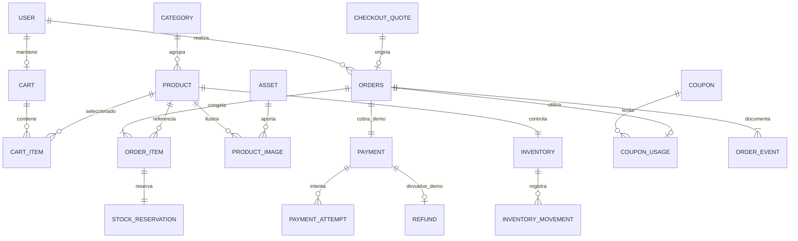

# NOVA STORE · Modelo de datos y catálogo inicial

Versión 1.0 · 27 de octubre de 2026 · Diseño lógico para PostgreSQL/Prisma.

**No es una migración ejecutada ni un schema Prisma compilado.** La traducción a la versión concreta del ORM, sus migraciones SQL y sus pruebas corresponde a E0/E1. Los archivos de imagen mencionados son nombres previstos, todavía no creados.

## 1. Convenciones

- Identificadores UUID generados en servidor; no usar un correlativo de pedido como credencial.
- `createdAt`, `updatedAt`, fechas de eventos y expiraciones: `timestamptz`, persistidos en UTC. Eventos guardan fecha del servidor, no del navegador.
- Importes: integer en centavos USD; tasas: integer en bps. Cálculo intermedio seguro según ARCHITECTURE. Cantidades siempre enteras.
- Campos `version`: integer positivo, incrementado en cada mutación del agregado. En Order incluye intentos de pago, aunque no cambie su estado.
- En tablas siguientes, `?` significa nullable, `UQ` único y `FK` relación. Todas tienen PK `id`, excepto las claves naturales expresamente indicadas.
- Nombres de campos en camelCase para TypeScript; mapear nombres SQL a snake_case si conviene, uniformemente.
- JSONB solo para snapshots, especificaciones y diferencias auditadas con esquema validado; no usarlo para sustituir líneas, relaciones, saldos o importes consultables.

## 2. Relaciones principales

El diagrama muestra relaciones del dominio; tablas auxiliares, claves y restricciones adicionales se describen abajo. Existe una sola fila de inventario por producto y una reserva por línea, ya que cada pedido agrupa un SKU una sola vez.

## 3. Identidad y catálogo

| Entidad | Campos principales | Relaciones y restricciones |
|---|---|---|
| User | emailNormalized, displayName, passwordHash, role, active, sessionVersion, createdAt, updatedAt | emailNormalized UQ; role CUSTOMER/ADMIN; sessionVersion >=1; email normalizado a trim/lowercase sin transformaciones específicas de proveedores |
| Category | slug, name, description?, sortOrder, active, version | slug UQ; 1:N Product; sin jerarquía en v1 |
| Product | sku, slug, name, description, specsJson, categoryId, status, unitPriceCents, compareAtPriceCents?, featured, version, createdAt, updatedAt | sku/slug UQ; FK Category; status DRAFT/ACTIVE/ARCHIVED; precio positivo; compareAtPrice > precio actual si se usa |
| Asset | storagePath, altDefault, width, height, sha256, provenanceType, sourceUrl?, authorOrProvider, licenseName, licenseUrl?, evidencePath, approvedAt?, approvedById?, createdAt | storagePath UQ; sha256 index; dimensiones positivas; procedencia ORIGINAL/GENERATED/LICENSED; aprobación antes de publicar |
| ProductImage | productId, assetId, alt, sortOrder | FK Product y Asset; UQ(productId, sortOrder); UQ(productId, assetId); primera posición es portada |
| Inventory | productId, onHand, reserved, reorderPoint, version, updatedAt | productId PK/FK Product; onHand >=0; reserved >=0; reserved <= onHand; reorderPoint >=0 |

La publicación de un producto exige categoría activa, texto, precio y una imagen aprobada. No hay listas de precios por cliente ni variantes. Desactivar categoría no altera pedidos ni reservas: deja de admitir nuevas cotizaciones de esos productos. No borrar una categoría referenciada; reasignar productos o desactivarla.

No crear Account, Session o VerificationToken «por costumbre»: la decisión inicial usa Credentials con usuarios gestionados por la aplicación y sesión JWT. Agregarlos solo si la integración de Auth.js escogida los necesita y se documenta el cambio. User no almacena información financiera.

## 4. Carrito, cotización y pedido

| Entidad | Campos principales | Relaciones y restricciones |
|---|---|---|
| Cart | userId, version, createdAt, updatedAt | userId UQ/FK User; como máximo un carrito servidor por usuario |
| CartItem | cartId, productId, quantity | UQ(cartId, productId); quantity 1–10; FK con borrado en cascada solo al borrar el carrito |
| CheckoutQuote | userId, cartId, cartVersion, shippingMethodCode, couponId?, settingsId, snapshotJson, payloadHash, expiresAt, createdAt | FK User/Cart/Coupon?/CommerceSettings; snapshot versionado y validado; no contiene secretos; una quote no promete disponibilidad |
| Order | publicNumber, userId, quoteId, status, version, eventSeq, currency, subtotalCents, discountCents, shippingCents, taxBaseCents, taxCents, shippingTaxCents, totalCents, taxBps, taxEnabled, taxShipping, settingsId, shippingMethodCode, shippingLabelSnapshot, deliveryEstimateSnapshot, addressSnapshot, customerSnapshot, couponSnapshot?, expiresAt, approvedAt?, shippedAt?, deliveredAt?, canceledAt?, cancelReason?, receiptNumber?, createdAt, updatedAt | publicNumber/quoteId/receiptNumber UQ; userId FK; settingsId FK; currency='USD'; estados en ARCHITECTURE |
| OrderItem | orderId, productId, skuSnapshot, nameSnapshot, imagePathSnapshot, unitPriceCents, quantity, subtotalCents, discountCents, taxCents, lineTotalCents | UQ(orderId, productId); FK Product conservada; quantity 1–10; subtotal=precio×cantidad; lineTotal=subtotal−descuento+impuesto |
| StockReservation | orderId, orderItemId, productId, quantity, status, expiresAt, consumedAt?, releasedAt?, releaseReason? | orderItemId UQ/FK; status ACTIVE/CONSUMED/RELEASED; cantidad positiva; no se elimina al cerrar pedido |

`addressSnapshot` contiene solo destinatario/alias, país EC, ciudad y dirección de ejemplo; retiro puede guardar solo punto ficticio. `customerSnapshot` contiene alias y email demo del momento. No capturar teléfono ni documento personal. El pedido conserva estos datos aunque el perfil cambie.

`snapshotJson` de quote contiene líneas con productId, versión, precio, cantidades, importes calculados, imágenes/nombres, envío, dirección y reglas comerciales necesarias. El hash se calcula sobre serialización canónica. La creación de Order compara con valores recargados; no basta verificar que la quote exista.

`couponSnapshot` congela código, tipo, valor, máximo de descuento y regla de mínimo; no depende de futuras ediciones del cupón. `settingsId` apunta a una versión inmutable además de los campos monetarios normalizados.

Formato propuesto de número público: `NOVA-DEMO-` + identificador aleatorio único legible; recibo `REC-DEMO-` + identificador único. No imitar numeración tributaria ni claves de autorización fiscal. La unicidad está garantizada en DB y se resuelve una colisión generando otro identificador.

## 5. Pagos, cupón y configuración

| Entidad | Campos principales | Relaciones y restricciones |
|---|---|---|
| Payment | orderId, status, amountCents, currency, provider, approvedAt?, refundedAt?, createdAt, updatedAt | orderId UQ/FK; provider='INTERNAL_SIMULATOR'; currency='USD'; estados PENDING/APPROVED/DECLINED/CANCELED/EXPIRED/REFUNDED |
| PaymentAttempt | paymentId, ordinal, outcome, scenario, amountCents, resultCode, idempotencyRecordId, createdAt | UQ(paymentId, ordinal); ordinal 1–5; outcome APPROVED/DECLINED/CANCELED; FK idempotency UQ; inmutable |
| Refund | paymentId, amountCents, reason, actorId?, actorType, idempotencyRecordId, createdAt | paymentId UQ/FK; un reembolso completo; actorType USER/ADMIN/SYSTEM; amount=Payment.amount incluso cuando es cero |
| Coupon | codeNormalized, type, percentBps?, amountCents?, maxDiscountCents?, minSubtotalCents, startsAt, endsAt, globalLimit?, perUserLimit?, active, version, createdAt, updatedAt | código UQ; tipo PERCENT/FIXED; exactamente un valor según tipo; límites positivos o null sin límite; startsAt < endsAt |
| CouponUsage | couponId, userId, orderId, status, reservedAt, redeemedAt?, releasedAt? | orderId UQ/FK; status RESERVED/REDEEMED/RELEASED; índices para conteo global y por usuario |
| CommerceSettings | versionNumber, isCurrent, taxEnabled, taxBps, taxShipping, standardFeeCents, expressFeeCents, pickupFeeCents, standardFreeThresholdCents, reservationMinutes, quoteMinutes, defaultReorderPoint, createdById?, createdAt | versionNumber UQ; único isCurrent=true; importes >=0; límites validados; la versión publicada es inmutable |

La configuración se actualiza insertando una nueva fila y cambiando el puntero lógico `isCurrent` en una transacción, con verificación de versión esperada. Solo el indicador isCurrent puede mutar en una fila histórica. `reservationMinutes=15` y `quoteMinutes=5` son decisiones iniciales: no exponer su edición en UI v1; cualquier cambio requiere revisión de reglas y pruebas. Los umbrales por producto ya asignados no se modifican al cambiar el umbral por defecto.

No hay números de tarjeta, titulares bancarios, CVV, tokens de pasarela, secretos por transacción, saldos bancarios ni respuestas de entidades financieras. `resultCode` usa códigos propios como DEMO_APPROVED, DEMO_DECLINED o DEMO_CANCELED.

## 6. Movimientos, eventos y operación

| Entidad | Campos principales | Relaciones y restricciones |
|---|---|---|
| InventoryMovement | productId, type, deltaOnHand, deltaReserved, onHandAfter, reservedAfter, causeKey, orderId?, orderItemId?, reservationId?, actorId?, actorType, reason, correlationId, createdAt | FK Inventory.productId y referencias opcionales; UQ(productId, causeKey); filas append-only |
| OrderEvent | orderId, seq, kind, orderFrom?, orderTo?, paymentFrom?, paymentTo?, actorId?, actorType, reason?, metadataJson, correlationId, createdAt | UQ(orderId, seq); secuencia desde Order.eventSeq; guarda cada paso, incluido reinicio de pago a PENDING |
| AuditLog | actorId?, actorType, action, entityType, entityId, beforeJson?, afterJson?, reason?, correlationId, createdAt | insert-only; incluir solo diferencias autorizadas sin hashes de contraseña, tokens ni direcciones completas |
| IdempotencyRecord | actorKey, scope, key, requestHash, resultCode, resultRef?, resultJson?, createdAt, expiresAt | UQ(actorKey,scope,key); actorKey resuelto por servidor; resultado compacto sin datos sensibles |
| RateLimitBucket | bucketKey, windowStart, count, expiresAt | UQ(bucketKey,windowStart); incremento atómico; clave de IP/usuario pseudonimizada; purga |
| JobRun | jobName, startedAt, finishedAt?, status, processedCount, failedCount, lastErrorCode? | status RUNNING/SUCCEEDED/FAILED; solo diagnóstico, nunca condición única para caducar pedidos |

`causeKey` para movimiento: `opening:{productId}`, `reserve:{reservationId}`, `sale:{reservationId}`, `release:{reservationId}`, `cancel-restock:{orderItemId}`, `adjust:{idempotencyRecordId}`. La liberación por caducidad y la liberación por cancelación comparten la misma clave porque solo una puede ocurrir. Todos los movimientos indican cantidades posteriores para inspección; no confiar solo en esas columnas para reconciliar.

Para expedientes de usuario/administración, actorId referencia User. Eventos SYSTEM usan actorId nulo y actorType SYSTEM. El identificador del job es un contexto de sistema verificable, no un userId recibido de una llamada pública.

## 7. Restricciones de integridad obligatorias

**En PostgreSQL, mediante migraciones versionadas: identifiers, NOT NULL, FK, UNIQUE, CHECK e índices parciales.** No suponer que una validación TypeScript cubre escrituras directas o errores de programación. Si Prisma no expresa una restricción, crear SQL de migración explícito y conservarlo al regenerar el esquema.

| Invariante | Protección |
|---|---|
| Inventario nunca negativo ni sobre-reservado | CHECK(onHand>=0 AND reserved>=0 AND reserved<=onHand) + UPDATE condicionado |
| Disponibilidad derivada | No almacenar una tercera columna available mutable |
| Un producto una vez por carrito/pedido | UQ(cartId,productId) y UQ(orderId,productId) |
| Un pedido por cotización | Order.quoteId UQ, además de idempotencia |
| Un pago y un reembolso por pedido | Payment.orderId UQ y Refund.paymentId UQ |
| Un solo intento aprobado por pago | Índice UNIQUE parcial sobre PaymentAttempt(paymentId) WHERE outcome='APPROVED' |
| Una reserva por línea | StockReservation.orderItemId UQ; comprobar correspondencia de order/product/quantity en servicio transaccional o FK compuesta |
| Movimientos no repetidos | UQ(productId,causeKey) |
| Solo configuración actual | Índice UNIQUE parcial sobre constante WHERE isCurrent=true; la transacción asegura que siempre exista una |
| Descuento acotado | CHECK 0<=discountCents<=subtotalCents en Order y OrderItem |
| Totales coherentes en una fila | CHECK total=subtotal−discount+shipping+tax; shippingTax entre 0 y tax; campos no negativos |
| Cantidades/precios/tasas válidos | CHECK según límites de ARCHITECTURE; cupones porcentaje 1–10000 bps o fijo positivo |
| Dirección/cotización JSON válida | Validación Zod versionada al escribir y leer; checks sencillos de tipo JSON si aportan valor |
| Secuencia histórica sin duplicados | UQ(orderId,seq), incremento bajo bloqueo de Order |

Invariantes que abarcan varias filas **no se resuelven con un CHECK que consulte otras tablas**. Las sumas de líneas, correspondencia Payment/Order, estados relacionados, usos de cupón y suma de reservas se garantizan en servicios transaccionales y se verifican mediante tests/reconciliación. Un trigger diferido puede reforzar un caso concreto si una prueba demuestra su necesidad; no sustituir el diseño por una red de triggers no documentada.

En una creación correcta: suma de OrderItem.subtotal = Order.subtotal; suma de descuentos = Order.discount; suma de impuestos de líneas + shippingTax = Order.tax; suma de lineTotal + shippingCents + shippingTax = Order.total.

## 8. Índices, consulta y búsqueda

- Product: status/categoryId/createdAt, status/unitPriceCents; SKU y slug únicos. Orden estable añade id como desempate.
- Catálogo de 30 productos: búsqueda parametrizada ILIKE, sin motor externo; normalizar espacios y mayúsculas. La búsqueda tolerante a tildes requiere una normalización documentada o extensión aprobada. No prometer fuzzy search en v1.
- Order: (userId,createdAt DESC,id), (status,expiresAt), approvedAt, createdAt. PaymentAttempt: (paymentId,ordinal). Refund: createdAt.
- StockReservation: (status,expiresAt), (productId,status). InventoryMovement: (productId,createdAt,id), orderId y correlationId.
- CouponUsage: (couponId,status), (couponId,userId,status). AuditLog: (createdAt,id), (entityType,entityId).
- CheckoutQuote/IdempotencyRecord/RateLimitBucket: expiresAt para purga. No borrar quotes que respaldan pedidos ni registros idempotentes referenciados por intentos/reembolsos; conservarlos junto con el pedido o aplicar una política de archivado que preserve referencias.
- Todas las listas se paginan en servidor; 12 por catálogo, 20 por tabla administrativa, máximo 100. La optimización posterior requiere EXPLAIN y medición, no índices indiscriminados.

## 9. Ciclo de vida, eliminación y reconciliación

Productos publicados se archivan; no se eliminan si aparecen en pedidos, movimientos o reservas. Un borrador sin referencias puede eliminarse junto a sus relaciones de imágenes y saldo cero; nunca eliminar el Asset si otros productos lo usan. Categorías/cupones referenciados se desactivan. Usuarios con pedidos no se borran físicamente desde UI; desactivación o anonimización controlada conserva contabilidad ficticia e historial.

FK históricas usan RESTRICT, salvo borrado de hijos puramente temporales (CartItem) o relaciones de un borrador sin referencias. No usar CASCADE desde User/Product hacia pedidos. No modificar precios/ítems/snapshots después de crear el pedido.

Reconciliación de solo lectura, ejecutable como comando de mantenimiento y prueba:

1. Por producto, saldo esperado = suma de todos los deltas desde OPENING; coincide con Inventory.
2. Inventory.reserved = suma de StockReservation.quantity con status ACTIVE, incluidas vencidas aún no procesadas.
3. Cada reserva consumida tiene un SALE; cada liberada tiene un RELEASE; cada línea cancelada tras aprobación tiene un CANCEL_RESTOCK.
4. Estados cruzados cumplen ARCHITECTURE y todo pago aprobado tiene exactamente un intento APPROVED.
5. Order coincide con suma de líneas y Payment.amount; Refund completo coincide con Payment y solo existe para cancelación pagada.
6. Usos de cupón no exceden límite aplicable. Reportar inconsistencias y fallar; no «arreglar» números silenciosamente.

## 10. Catálogo inicial de 30 productos

Nombres, especificaciones y precios son ficticios. Cada fila representa un SKU único, sin marcas ajenas ni variantes. `stock` es saldo inicial **antes** de ejecutar escenarios de pedidos. Todos empiezan con reserved=0 y reorderPoint=5. Los SKU 005 y 030 ejercitan agotamiento; 003, 015, 018, 021 y 027 ejercitan alertas.

El archivo previsto para cada SKU es `public/images/products/{sku-en-minusculas}.webp`; ejemplo NOV-001 → `nov-001.webp`. Cada archivo debe mostrar el producto correspondiente; no se acepta una misma imagen genérica para los 30 productos. Las descripciones y alt se expanden desde esta tabla durante E1.

| SKU | Categoría | Producto | USD | Stock | Especificación / contenido visual previsto |
|---|---|---|---:|---:|---|
| NOV-001 | Tecnología | Auriculares Aura | 59.90 | 18 | Diadema inalámbrica gris, autonomía ficticia 24 h |
| NOV-002 | Tecnología | Altavoz Orbital | 39.90 | 24 | Altavoz compacto cilíndrico azul, 10 W ficticios |
| NOV-003 | Tecnología | Teclado Línea | 49.90 | 4 | Teclado compacto español de 75%, blanco |
| NOV-004 | Tecnología | Ratón Vector | 24.90 | 32 | Ratón inalámbrico negro, tres niveles de sensibilidad |
| NOV-005 | Tecnología | Cámara Prisma | 44.90 | 0 | Webcam con cubierta física, 1080p ficticio |
| NOV-006 | Escritorio | Lámpara Arco | 34.90 | 16 | Lámpara orientable marfil, tres tonos de luz |
| NOV-007 | Escritorio | Soporte Plano | 29.90 | 21 | Soporte plegable de aluminio para portátil |
| NOV-008 | Escritorio | Organizador Módulo | 18.50 | 30 | Bandeja modular de escritorio, tres compartimentos |
| NOV-009 | Escritorio | Cuaderno Trama | 12.90 | 45 | Cuaderno A5, 160 páginas punteadas, cubierta verde |
| NOV-010 | Escritorio | Base de escritorio Lienzo | 22.90 | 20 | Tapete textil grafito de 80 × 30 cm |
| NOV-011 | Hogar | Vaso térmico Horizonte | 19.90 | 28 | Vaso de acero mate, 450 ml, tapa a presión |
| NOV-012 | Hogar | Cafetera Niebla | 32.90 | 12 | Prensa francesa de vidrio, 600 ml |
| NOV-013 | Hogar | Jarrón Duna | 27.90 | 11 | Jarrón cerámico arena, 22 cm de alto |
| NOV-014 | Hogar | Reloj Órbita | 29.90 | 17 | Reloj de pared minimalista, 28 cm |
| NOV-015 | Hogar | Manta Nube | 39.90 | 3 | Manta de tejido suave, 130 × 170 cm, crema |
| NOV-016 | Movilidad | Mochila Trayecto | 54.90 | 14 | Mochila urbana de 18 L, verde oscuro |
| NOV-017 | Movilidad | Botella Ruta | 21.90 | 26 | Botella metálica, 750 ml, azul profundo |
| NOV-018 | Movilidad | Riñonera Giro | 24.90 | 5 | Bolso de cintura compacto negro, 2 L |
| NOV-019 | Movilidad | Estuche Viaje | 16.90 | 22 | Organizador textil de cables y pequeños accesorios |
| NOV-020 | Movilidad | Paraguas Refugio | 25.90 | 13 | Paraguas plegable gris con funda |
| NOV-021 | Bienestar | Esterilla Equilibrio | 35.90 | 2 | Esterilla de ejercicio, 183 × 61 cm, lavanda |
| NOV-022 | Bienestar | Bloque Apoyo | 11.90 | 36 | Bloque de corcho para ejercicio, bordes redondeados |
| NOV-023 | Bienestar | Bandas Impulso | 18.90 | 25 | Juego de tres bandas elásticas de resistencia |
| NOV-024 | Bienestar | Rodillo Calma | 26.90 | 15 | Rodillo de espuma texturizado, 33 cm |
| NOV-025 | Bienestar | Toalla Brisa | 14.90 | 31 | Toalla de microfibra, 80 × 40 cm, coral |
| NOV-026 | Accesorios | Funda Portátil | 28.90 | 19 | Funda acolchada para portátil de 14 pulgadas |
| NOV-027 | Accesorios | Cargador Nodo | 29.90 | 1 | Adaptador USB-C, potencia ficticia 30 W, blanco |
| NOV-028 | Accesorios | Cable Conexión | 9.90 | 50 | Cable USB-C de 1,5 m, trenzado grafito |
| NOV-029 | Accesorios | Hub Puente | 42.90 | 10 | Adaptador multipuerto compacto de aluminio |
| NOV-030 | Accesorios | Base Energía | 27.90 | 0 | Base circular de carga, 15 W ficticios |

No usar especificaciones como garantía de un producto real; todos son representaciones educativas. Las seis categorías tienen cinco productos cada una. SKU 027 con una unidad es el fixture de última unidad; para pruebas paralelas crear una copia aislada de la base, no depender de su saldo en una demo compartida.

### Procedencia y uso de imágenes

Ruta preferida: fotografías/ilustraciones originales propias o generadas para este proyecto, sin logos ni productos reconocibles de terceros, con registro de procedencia y términos de uso aplicables. Alternativa: fotografías licenciadas seleccionadas individualmente y descargadas conforme a su licencia. No asumir que el resultado de un buscador es reutilizable ni que «generada» equivale a derechos exclusivos garantizados.

Crear `assets-manifest.json` con una entrada por archivo: SKU, ruta, título, alt, autor/proveedor, tipo de origen, URL de origen si existe, licencia/condiciones, URL de licencia, fecha de revisión, evidencia local, cambios realizados y sha256. En imágenes originales/generadas sustituir URL de origen por referencia a su creación y conservar condiciones aplicables; no inventar atribuciones o licencias CC0.

Una fuente opcional es la [licencia oficial de Unsplash](https://unsplash.com/license), consultada el 27-10-2026. Sus condiciones generales no sustituyen revisar cada recurso, posibles marcas/personas y los términos del método de descarga o API. No usar Unsplash+ bajo la licencia gratuita ni depender de URLs aleatorias/hotlinks como entrega final. La decisión inicial evita la API y sirve recursos propios aprobados desde el proyecto.

**Puerta de publicación:** 30 recursos asignados, visibles, coherentes con sus fichas, sin marcas ajenas, con evidencia de permiso y créditos cuando correspondan. Si falta evidencia, el producto no puede pasar a ACTIVE. Este paquete define ese requisito; no afirma haber seleccionado o autorizado fotografías concretas.

## 11. Otros datos de prueba

| Dato | Valor inicial |
|---|---|
| Clientes | `cliente1@example.test`, `cliente2@example.test`; alias ficticios; contraseñas proporcionadas por entorno de seed, no en repo |
| Administrador | `admin@example.test`; contraseña secreta de entorno; no mostrar credenciales en página pública |
| Envío estándar | USD 4,99; gratuito desde USD 80,00 netos; plazo ficticio 3–5 días |
| Envío exprés | USD 9,99; sin gratuidad; plazo ficticio 1–2 días |
| Retiro | USD 0,00; «Punto NOVA de demostración», sin dirección de negocio real |
| Cupón NOVA10 | 10%, mínimo USD 40, máximo descuento USD 20; límite global 100, por usuario 2 |
| Cupón DEMO15 | USD 15 de descuento, mínimo USD 50; límite global 50, por usuario 1 |
| Impuesto | Deshabilitado; escenario de test habilita 1000 bps, taxShipping=false |
| Direcciones | Alias de cliente, ciudad Guayaquil/Quito/Cuenca y texto «Dirección ficticia de demostración» |

Fechas de cupón definidas respecto de un `seedEpoch` reproducible, no números absolutos que vuelvan inútil la demo. Guardar ese epoch en metadatos de seed; al reejecutar no extender silenciosamente vigencias. El reloj de tests puede inyectarse/controlarse por fixture sin exponer un parámetro público para cambiar la hora del servidor.

Escenarios avanzados: pedido aprobado, rechazado pendiente, intento cancelado, reserva vencida, cancelado antes de pagar, cancelado con reembolso, en preparación, enviado y entregado. Generarlos mediante los mismos servicios/reglas o mediante fixtures que demuestren invariantes completas; no insertar estados aislados sin sus movimientos. Fechas variadas de los últimos 30 días para gráficos, con metadatos explícitos de seed.

## 12. Seeds y migraciones

1. Seed base idempotente por claves estables; crea lo que falta, no sobreescribe productos editados ni reinicia inventario de una instalación existente.
2. Cada alta de inventario genera OPENING una sola vez. Saldo y movimiento nacen en la misma transacción.
3. Seed de escenarios separado del seed base. Su identificador estable impide duplicar pedidos si se repite. Si encuentra una ejecución parcial, reconciliar y reportar antes de continuar.
4. Test fixtures crean base/esquema aislado y determinista. No ejecutar seed destructivo contra una demo persistente.
5. Reset exclusivamente por comando de mantenimiento, con verificación de entorno/destino y confirmación explícita al ejecutarlo. Ninguna ruta pública ni botón de administrador ejecuta truncados.
6. Migraciones versionadas, revisadas y probadas desde base vacía y desde la versión anterior. No usar `db push` como sustituto del historial de producción.
7. Ejecutar reconciliación tras seed y migración. Bloquear entrega si aparecen saldos, importes o estados incoherentes.
